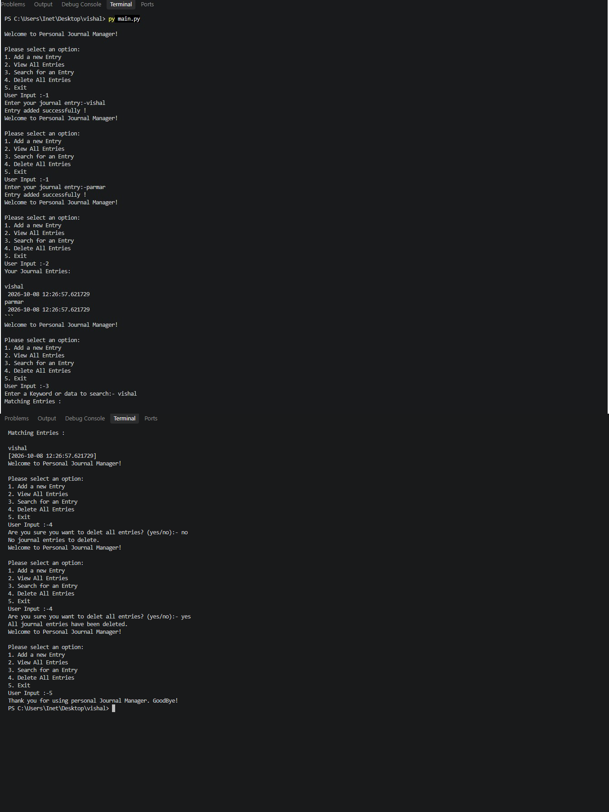
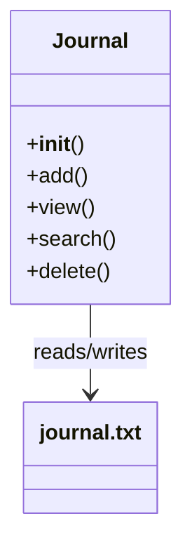
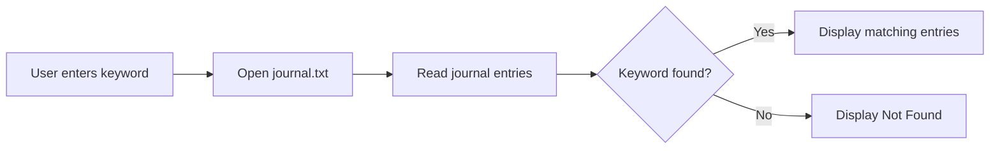
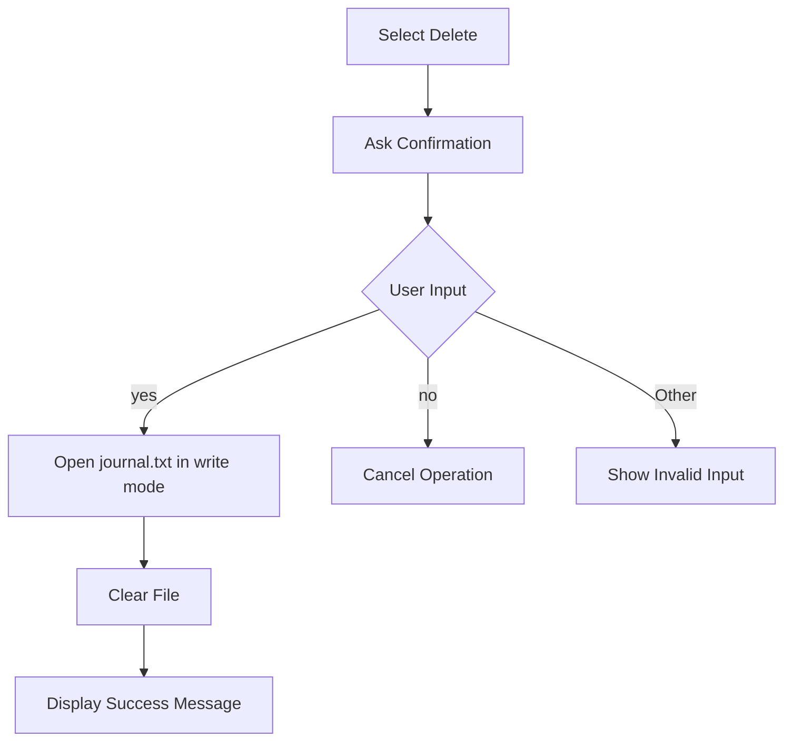

---

# 📌 Project Title

# Personal Journal Manager

---

## 📝 Project Description

The **Personal Journal Manager** is a Python-based console application designed to manage personal journal entries.

The application stores journal entries permanently in a file named:

```text
journal.txt
```

Each journal entry contains:

* 📅 Date and Time
* ✍️ Journal Entry
* 🔍 Searchable Content

The project demonstrates important Python concepts such as:

* Classes and Objects
* File Handling
* Exception Handling
* Loops
* Conditional Statements
* Functions and Methods
* Date and Time Handling
* String Processing

---

## 🎯 Objectives

The main objectives of this project are:

1. To create a simple personal journal application.
2. To store journal entries in a text file.
3. To allow users to add new entries.
4. To display all saved entries.
5. To search for journal entries using keywords or dates.
6. To delete all journal entries when required.
7. To demonstrate Python file handling and OOP concepts.

---

## ⭐ Features

| No. | Feature         | Description                                |
| --- | --------------- | ------------------------------------------ |
| 1   | ➕ Add Entry     | Add a new journal entry                    |
| 2   | 📖 View Entries | Display all saved entries                  |
| 3   | 🔎 Search       | Search entries using keywords or dates     |
| 4   | 🗑️ Delete      | Delete all journal entries                 |
| 5   | 🚪 Exit         | Close the application                      |
| 6   | 🕐 Date & Time  | Automatically stores current date and time |
| 7   | 💾 File Storage | Stores data in `journal.txt`               |


## 🏗️ Project Architecture

```text
                ┌──────────────────────────┐
                │   Personal Journal       │
                │       Manager            │
                └────────────┬─────────────┘
                             │
                             ▼
                  ┌────────────────────┐
                  │    Main Menu       │
                  └─────────┬──────────┘
                            │
             ┌──────────────┼──────────────┐
             ▼              ▼              ▼
        ┌─────────┐    ┌─────────┐    ┌─────────┐
        │  Add    │    │  View   │    │ Search  │
        │ Entry   │    │ Entries │    │ Entries │
        └────┬────┘    └────┬────┘    └────┬────┘
             │              │              │
             └──────────────┼──────────────┘
                            ▼
                    ┌──────────────┐
                    │ journal.txt  │
                    │ File Storage │
                    └──────────────┘
                            ▲
                            │
                       ┌────┴────┐
                       │ Delete  │
                       │ Entries │
                       └─────────┘
```

---

## 📂 Project Structure

```text
│
├── main.py
│
├── journal.txt
│
├── output.png
│
└── README.md
```

### File Description

| File                 | Description            |
| -------------------- | ---------------------- |
| `main.py`            | Main Python program    |
| `journal.txt`        | Stores journal entries |
| `output.png`         | Project output images  |
| `README.md`          | Project documentation  |

---

## output



## 🧩 Class Structure

The project uses a Python class called `Journal`.



### Journal Class

The `Journal` class provides four main operations:

```text
Journal
   │
   ├── add()
   │     └── Add new journal entry
   │
   ├── view()
   │     └── Display all entries
   │
   ├── search()
   │     └── Search entries
   │
   └── delete()
         └── Delete all entries
```

---

## 💾 File Handling

The project uses Python's built-in `open()` function.

### Append Mode

Used when adding a new journal entry:

```python
with open("journal.txt", "a") as file:
    file.write(...)
```

`"a"` means **append mode**.

It adds new information without removing existing entries.

### Read Mode

Used to view or search journal entries:

```python
with open("journal.txt", "r") as file:
    data = file.read()
```

`"r"` means **read mode**.

### Write Mode

Used to delete all entries:

```python
with open("journal.txt", "w") as file:
    pass
```

`"w"` clears the existing file contents.

---

## 🕐 Date and Time

The project uses Python's `datetime` module:

```python
from datetime import datetime
```

The current date and time are obtained using:

```python
dt = datetime.now()
```

Example:

```text
Date & Time: 2026-10-08 12:47:25
```

---

## 🔍 Search Process



The search can be performed using:

```text
Keyword
   ↓
"Python"
   ↓
Search journal.txt
   ↓
Matching entries
```

---

## 🗑️ Delete Process



---

## 🖥️ Sample Output

### Main Menu

```text
========================================
   Welcome to Personal Journal Manager!
========================================

Please select an option:
1. Add a new Entry
2. View All Entries
3. Search for an Entry
4. Delete All Entries
5. Exit

User Input:
```

### Add Entry

```text
User Input: 1

Enter your journal entry:
Today I learned Python file handling.

Entry added successfully!
```

### View Entries

```text
Your Journal Entries:

----------------------------------------
Date & Time: 2026-10-08 12:47:25
Entry: Today I learned Python file handling.
----------------------------------------
```

### Search

```text
Enter a keyword or date to search:
Python

Matching Entries:

Date & Time: 2026-10-08 12:47:25
Entry: Today I learned Python file handling.
```

---

## 🛠️ Technologies Used

```text
┌─────────────────────────┐
│      Technologies       │
├─────────────────────────┤
│ 🐍 Python               │
│ 💻 VS Code              │
│ 📁 File Handling        │
│ 🔧 Git                  │
│ 🌐 GitHub               │
└─────────────────────────┘
```

### Technology Details

* **Python** – Main programming language
* **VS Code** – Code editor
* **Git** – Version control
* **GitHub** – Project repository
* **Text File** – Data storage

---

## ⚙️ Installation / Setup

### Step 1: Install Python

Make sure Python 3.x is installed on your computer.

Check the version:

```bash
python --version
```

or:

```bash
python3 --version
```

### Step 2: Open the Project

Open the project folder in **VS Code**.

### Step 3: Run the Program

Open the VS Code terminal and run:

```bash
python main.py
```

### Step 4: Use the Menu

Select an option from:

```text
1 → Add Entry
2 → View Entries
3 → Search Entry
4 → Delete Entries
5 → Exit
```

---

## 🔄 Application Workflow

```text
             START
               │
               ▼
        ┌──────────────┐
        │  Main Menu   │
        └──────┬───────┘
               │
       ┌───────┼────────┐
       │       │        │
       ▼       ▼        ▼
      ADD     VIEW    SEARCH
       │       │        │
       └───────┼────────┘
               │
               ▼
          journal.txt
               │
               ▼
            DELETE
               │
               ▼
             EXIT
```


## 🔐 Exception Handling

The program uses `try-except` blocks to prevent the application from crashing when an error occurs.

Example:

```python
try:
    choice = int(input("User Input: "))
except ValueError:
    print("Enter only numbers from 1 to 5.")
```

This handles invalid user input.

## 🚀 Future Enhancements

The project can be improved by adding:

* 🔐 Password protection
* 🗄️ SQLite database
* 📝 Edit existing entries
* 📅 Search by specific date
* 📊 Journal statistics
* 🖥️ Graphical User Interface (GUI)
* 🌙 Dark mode
* 📤 Export entries to PDF
* 🔒 Encryption for private journal entries

---

## ✅ Advantages

* Simple and easy to use
* Beginner-friendly Python project
* No database required
* Works offline
* Stores data permanently
* Demonstrates Object-Oriented Programming
* Demonstrates file handling
* Easy to modify and extend

---

## ⚠️ Limitations

* Data is stored in a normal text file.
* No password protection.
* No graphical interface.
* Deleting entries removes all entries.
* Multiple users are not supported.

---

## 👨‍💻 Author / Developer

**Developer Name:** Vishal Parmar


---

## 📄 License

This project is created for **educational and academic purposes**.

---

# ⭐ Thank You

Thank you for using the **Personal Journal Manager**!

